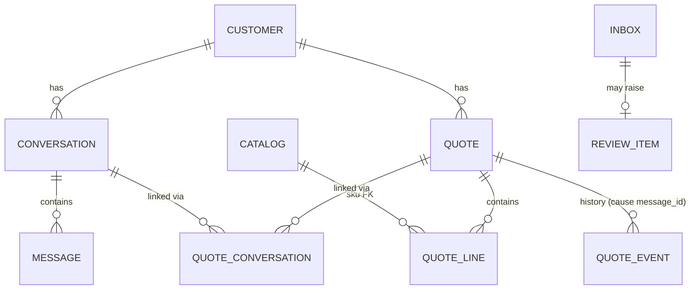

# Quote & State Engine

A headless API that turns colloquial WhatsApp conversations into draft quotes ("Oferta de Venta": SKUs + quantities, no pricing) and keeps them correct as messages keep arriving: revisions, a colleague asking from another chat, new requests mixed with old ones.

**In one line:** a small local model *interprets* text into a typed structure, deterministic code *decides* which quote a message touches, and anything ambiguous goes to a human instead of the ERP. Postgres is the only stateful dependency; inference is 100% local (Docker Model Runner + Qwen3-4B-Instruct-2507).

Depth: [docs/HLD.md](docs/HLD.md) (architecture, rationale) · [docs/LLD.md](docs/LLD.md) (schema, algorithms, API).

## 1. Quickstart

Requirements: Docker with Compose (`models:` support) and the Docker Model Runner plugin (`docker model`), [`just`](https://github.com/casey/just) (`uv tool install rust-just`), `curl`, `jq`.

```bash
just demo          # real model: builds, pulls the GGUF (~2.5 GB, first run only), runs the challenge end to end
just demo-replay   # no model: LLM outputs served from recorded fixtures; runs anywhere Docker runs
just up-gpu        # NVIDIA: reinstall the model runner with CUDA, then start the stack (then ./scripts/demo.sh)
just down          # stop and wipe the database volume
```

`scripts/demo.sh` posts Phase 1, then events 1–4 (printing the quotes after each), resends event 4 (duplicate), posts "mejor cancelalo" (review), prints the history of Q-002 and checks the final state against the challenge's expected JSON. On a CPU-only machine Phase 1 took ~80 s (round-1 measurement, 4-SKU catalog); `?wait=true` waits up to 300 s.

The API listens on `${API_PORT:-8000}` (`API_PORT=8080 just demo` if 8000 is taken). Postgres has no host port. Some calls:

```bash
API=http://localhost:${API_PORT:-8000}
curl -s -X POST "$API/v1/conversations?wait=true" -H 'content-type: application/json' -d @fixtures/challenge/phase1.json
curl -s -X POST "$API/v1/messages?wait=true"      -H 'content-type: application/json' -d @fixtures/challenge/event4.json
curl -s "$API/v1/quotes?customer=C-10029" | jq          # the challenge's GET /quotes shape
curl -s "$API/v1/quotes/Q-002/history" | jq             # every event + the message that caused it
curl -s "$API/v1/reviews?customer=C-10029" | jq         # open human-review items with candidate quotes
REVIEW_ID=$(curl -s "$API/v1/reviews?customer=C-10029" | jq '.[-1].id')   # e.g. the "mejor cancelalo" review
curl -s -X POST "$API/v1/reviews/$REVIEW_ID/resolve" -H 'content-type: application/json' \
  -d '{"action":"apply","quote_id":"Q-002","expected_version":2,"ops":[{"op":"cancel"}]}'
curl -s "$API/health" | jq                              # {db, llm, model, model_present}
```

Without `?wait=true`, a POST returns `202 {inbox_seq, status_url}` immediately and `GET /v1/inbox/{seq}` shows the outcome and the full decision trace. State survives restarts (`docker compose restart api worker`).

Dev loop: `just test` (unit + integration on a testcontainers Postgres; no model needed), `just test-llm`, `just lint`, `just typecheck`, `just eval mode=cascade|llm|rules`.

**Ops note (model runner).** Compose sets `context_size: 8192` for the stack itself. Host-side runs (`just eval`, `just test-llm`) use the runner's per-model setting, which `docker restart docker-model-runner` drops; the model then starts with its 262k default context and runs out of memory. After a restart run `docker model configure --context-size 8192 hf.co/unsloth/Qwen3-4B-Instruct-2507-GGUF:Q4_K_M` once before host-side runs. The first call after a (re)load takes minutes on CPU; warm calls are ~27 s.

## 2. Data model, and how a message finds its quote



Conversation ↔ quote is **many-to-many** through `quote_conversations(quote_id, conversation_id, linked_by_message_id, linked_at)`. Neither side holds the other's id, so event 2 (two chats → one quote) and event 3 (one chat → two quotes) are just rows. After the four events:

| quote_id | conversation_id | linked_by_message_id |
|---|---|---|
| Q-001 | wa-thread-411 | Phase 1 (synthetic id of the last history message) |
| Q-001 | wa-thread-662 | wamid.662.0001 (event 2) |
| Q-002 | wa-thread-411 | wamid.411.0232 (event 3) |
| Q-002 | wa-thread-662 | wamid.662.0002 (event 4) |

Everything else is plumbing around one idea: the **inbox** table is the webhook log, the dedupe index and the work queue at once, so dedupe and the state change commit in the same transaction.

**What decides the quote:** the router scores **every open quote of the customer** on the message *content*: +10 for an explicit quote id, +3 per mentioned product that the quote contains, +2 if the "previous quantity" matches a line. A unique positive maximum wins; a tie or zero goes to review. The chat the message arrived in is not a signal, with one exception: "agrega X" without "aparte" goes to the quote linked to this chat if there is exactly one.

### Event 4, function by function

*"perfecto. y de los acrilicos que cotizó Alice, mejor que sean 4"* arrives in Mario's chat `wa-thread-662`, which so far is linked only to Q-001.

1. `adapters/api/routes.py` · `post_message` validates the body as `MessageIn` and opens a `UnitOfWork`.
2. `application/ingest.py` · `ingest_message` hashes the canonical payload and calls `InboxRepo.insert` (`INSERT … ON CONFLICT (dedupe_key=message_id) DO NOTHING`). New → `Accepted(seq)` → 202. Same id and hash → 200 duplicate; same id, different payload → 409.
3. `worker.py` · `run` loops `application/process.py` · `process_next`, which in one transaction: `InboxRepo.claim` (oldest pending row whose customer has no earlier pending row, `FOR UPDATE SKIP LOCKED`), `pg_advisory_xact_lock(hashtext('C-10029'))`, opens a savepoint and calls `_message`.
4. `_message` stores the message (`MessageRepo.upsert_customer_conversation`, `recent`, `add`) and builds a `MessageCtx` with the last 10 chat messages.
5. `adapters/extractors/cascade.py` · `CascadeExtractor.interpret` tries `adapters/extractors/rules.py` · `RuleExtractor.interpret` first: `norm` → `_intent` matches "mejor que sean" → `update_qty`; the alias "acrilicos" → `[ARACBL-03-122244]`; `_bind` ties "sean 4" to it → `qty=4`. Every number is bound, so the rules are confident: `source="rules"`, **no LLM call**.
6. `domain/interpretation.py` · `validate_skus` re-checks the SKUs against the catalog.
7. `QuoteRepo.open_views("C-10029")` → Q-001 {lona 15, mesh 5, micro 5; chats 411, 662} and Q-002 {acrilico 2; chat 411}.
8. `domain/router.py` · `route` → `_pick` → `score`: **Q-001 = 0, Q-002 = 3** → Q-002. `_resolve_line` finds the single acrilico line → `Apply("Q-002", [LinkConversation("wa-thread-662"), SetQty("ARACBL-03-122244", 4)])`. The chat's existing link to Q-001 played no part.
9. `_execute` → `QuoteRepo.get_for_update("Q-002")` → `domain/quote.py` · `Quote.apply(ops, Cause("wamid.662.0002"))` validates the whole batch and emits `ConversationLinked(wa-thread-662)` and `LineQtyChanged(2→4)`; version 1 → 2.
10. `adapters/db/repos.py` · `QuoteRepo.save` upserts the quote row and lines, inserts the `quote_conversations` link (`linked_by_message_id=wamid.662.0002`) and the two `quote_events`; `InboxRepo.finish` stores `processed` plus the trace (interpretation, scores, decision, latency). Commit.

## 3. "mejor cancelalo"

With Q-001 and Q-002 open, "mejor cancelalo" has no content signal: no product, no quote id. The rules read it as a bare `cancel`, and the router only auto-applies a bare cancel when the customer has exactly **one** open quote. Here it returns `Review(ambiguous_quote, [Q-001, Q-002])`: the worker writes a `review_items` row with the message, the interpretation and both candidates, marks the inbox row `needs_review`, and **changes nothing**. A person sees it at `GET /v1/reviews` (candidates with their lines and versions) and decides with `POST /v1/reviews/{id}/resolve`, passing explicit ops and the `expected_version` of the quote; if the quote changed in the meantime the API answers 409 instead of applying a stale decision. The resulting events carry both the original `message_id` and the `review_id`. Other messages from the customer keep flowing while the review is open. This is implemented and covered by integration tests, not only described.

## 4. Deterministic vs. model

| Step | Who | What it may decide | What it must never decide | When it is wrong / gives up |
|---|---|---|---|---|
| Dedupe | Postgres unique index on `message_id` + payload hash | new / duplicate / conflict | — | — |
| Phase 1 extraction (whole conversation) | **LLM**, JSON-schema constrained | items + qty, reading both directions; `in_catalog=false` for what we don't sell | a SKU outside the catalog (schema `enum`, then `validate_skus`, then a DB foreign key) | a wrong qty lands in a *draft* a human reviews before the ERP; any not-in-catalog item, no items or failure → review, no quote |
| Phase 2 interpretation | **Rules first** (`RuleExtractor`), LLM only when the rules return `None` | intent, product → candidate SKUs (or `in_catalog=false`), qty, previous qty, "aparte", explicit quote ids | which quote; any state change | rules give up on unknown wording, any unbound number, negated cancel, add + set in one message, a query with a qty, a cancel that names anything → LLM. LLM failure / timeout / foreign SKU → review |
| Is the message assertive | **Guard** (`adapters/extractors/guards.py`), pure code over the raw text, after every extractor | pass; rewrite "quitale 2" / "2 mas" into a relative change of one existing line; give up | add a mutation | questions, hedges, conditionals, negations, swaps, unsold units, temporal references → give up (rules → LLM, LLM → review) |
| Which quote | **Router**, pure code | target quote, new quote, review, no-op | — | tie, zero score, ambiguous line, update without a product → review |
| Is the change valid | **Quote aggregate** | accept / reject the op batch, all-or-nothing | — | `DomainError` → nothing applied, review `invalid_ops` with the rejected `Apply` as `proposed` |
| Ambiguity | **Human** via `/v1/reviews` | explicit ops | — | stale version → 409 |

The model never sees the quotes and never picks one; it only fills a typed form. Prompts are in `adapters/extractors/llm.py`; the model is called with temperature 0, 2 validation retries and a 180 s timeout, and sees only the catalog families the message mentions (see §5).

## 5. Catalog, and products we don't sell

**Catalog.** `fixtures/catalog.json` holds **39 SKUs** in six families: lona (Frontlit ×6, Blackout ×4, Mesh ×2), vinil adhesivo (brillante, mate, transparente, microperforado; ×12), acrílico (blanco 2/3/5 mm, transparente 3/5 mm, negro 3 mm), PVC espumado (3/5/10 mm), laminado (brillante, mate) and tinta ecosolvente (CMYK, 1 L). The 4 challenge SKUs are unchanged. Besides `description` and `aliases`, each SKU has structured `attrs` — `family`, `type`, `width_m`, `length_m`, `thickness_mm`, `color`, and `weave` (only the mesh "9x9", so "lonas 9x9" means mesh) — plus a `default` flag. The rules filter by these attributes with exact values, never by substrings of the description. The file is the single source: the API seeds `sku/description/aliases` into the `catalog` table (the foreign-key guard), and the worker loads `attrs`/`default` from the file.

**Family default (business rule).** "lona" with no type means **Frontlit** — but only for a **brand-new line** (a new quote, or an "agrega" that matches no existing line of the quote), and only when exactly one Frontlit SKU is left after the size filter: "cotizame 8 rollos de lona 2.20" → Frontlit 2.20x100 (not Blackout 2.20x100); "cotizame 8 lonas de 2.50" → review (Frontlit 2.50x100 and 2.50x50 both fit); "necesito 6 lonsa frontlit" with no size → review (six Frontlit sizes). Updates, removals and questions never use the default: they keep every candidate and intersect with the quote, so event 1 still needs "no 20" to pick the Frontlit line. No other family has a default.

**Not in catalog.** A product, size, thickness or colour we don't carry becomes an item with `in_catalog=false` and no SKU; there is no path from it to a quote line.

* **Rules:** the attribute filter leaves no SKU ("lona 5x100", "acrílico rojo", "sintra 20mm") → `in_catalog=false`. A word that is not an alias at all ("papel fotográfico") is not seen by the rules, so they give up and the LLM decides.
* **LLM:** told to return `in_catalog=false` instead of the closest SKU, with a worked example.
* **Router:** any `in_catalog=false` item in an order (new, add, update, remove, cancel) → review `unknown_product`, the **whole message**: no partial apply of the products we do sell. A cancel naming a product we don't sell ("cancela lo del papel fotográfico") is also a review: the message signals confusion and cancel is the most destructive intent. A **question** about something we don't sell drops those items: no-op, or a link if a quote is clearly meant.
* **Phase 1:** a conversation with any not-in-catalog item → review `unknown_product` with the proposed lines stored on the review; no quote is created.

**LLM family pre-filter.** With 39 SKUs, sending the whole table plus a 39-value `enum` in every prompt made a CPU call take **54–205 s**. `domain/catalog_filter.py` · `relevant_skus` detects the families the message (and its recent history) mentions from alias tokens, with typo tolerance, and the prompt and schema carry only those SKUs (cached per family set); if no family is detected the full catalog is sent. A warm call is now **~27 s** on the same VM. If the filter misses a family, the model cannot choose a wrong SKU from it: it should answer `in_catalog=false` → review.

**Post-extraction Guard.** The rules and the LLM both misread non-assertive Spanish ("cuanto me sale si llevo 10 en vez de 20?", "la de ayer cambiala a 10"), so `adapters/extractors/guards.py` · `Guard` re-reads the raw text after every extractor and gives up (rules → LLM; LLM → review) on questions, hedges, negations, swaps, units we don't sell by, references to quotes we can't see, and order verbs read as no-ops; relative changes ("quitale 2", "5 lonas menos") are read from the text as a `qty_delta`, never from the extractor's qty, and a relative cue it can't read goes to review. Every rejection logs `guard_rejected rule=…` so it is told apart from a model failure; the rule list is in `docs/LLD.md` §Guard.

It is a deterministic net biased to review and cannot cover all of Spanish: an unknown non-assertive phrasing can still reach the router as an order. Next step: an additive `mood` field (`assertive | question | hypothetical | negated`) classified by the model, with the Guard kept as a second check.

## 6. Edge cases

| Case | What the system does | Why |
|---|---|---|
| "mejor cancelalo", 2 open quotes | review, no change | no content signal; guessing would push a wrong cancel |
| "mejor cancelalo", 1 open quote | cancels it | unambiguous |
| Event 4 resent byte-identical | 200 duplicate, state and version unchanged | dedupe on `message_id` + hash |
| Same `message_id`, different payload | 409 | a reused id is a client bug, not a repeat |
| Same text, new `message_id` | applied again | a real repeat request; never dedupe on text |
| "mejor que sean 15 las lonas" (quote has frontlit **and** mesh) | review `ambiguous_line` | "lonas" matches two lines; "no 20" (event 1) is what disambiguates |
| Same product in two open quotes | review `ambiguous_quote` (tie) | content can't separate them |
| "Q-002 …" in the text | that quote wins (+10) | explicit beats inferred |
| "agrega 2 acrilicos" (no "aparte"), chat linked to 1 quote | added there; if the SKU exists, qty is incremented | "add" reads as increment; chat linked to 0 or 2+ quotes → review |
| "mejor que sean 10" (no product) | review `unknown_product` | a link-only "success" would silently drop the update |
| Phase 1 thread posted again | review | must not create a duplicate quote |
| Outbound (rep) message in Phase 2 | stored as LLM context, never mutates | only the customer's requests change quotes |
| LLM down, times out, or returns junk | review `extraction_failed` | no state change without a confident interpretation |
| Same product twice in one message ("2 acrilicos … y 3 acrilicos") | quantities summed into one line for add/new; an update/remove giving one line two different qtys → review `ambiguous_line` | one line per SKU is a quote invariant |
| Decision rejected by the quote aggregate (`DomainError`) | review `invalid_ops`, inbox row `needs_review`, no change | every non-success outcome lands in `review_items` |
| Worker crash or infrastructure error mid-message | crash: rollback, row stays pending and is retried; exception: attempt counted, `failed` after 3 | claim + work + status in one transaction |
| Quote ids skip a number (Q-003 → Q-005) | cosmetic: ids are unique, not dense | Postgres sequences are non-transactional; a rolled-back creation burns an id |
| Two workers, same customer | processed strictly in arrival order | claim skips rows with an earlier pending row for the same customer + advisory lock |
| "cotizame 3 rollos de lona 5x100" (a size we don't sell) | review `unknown_product`, no change | the attribute filter leaves no SKU → `in_catalog=false`; never the closest size |
| "agrega 2 sintras de 5mm y 1 acrilico rojo" (sold + not sold) | the whole message → review `unknown_product`; the sintras are not added either | no partial apply; a human sees the full request |
| "tienen lona de 5 metros de ancho?" | no-op | a question about a product we don't carry changes nothing and needs no human |
| "cancela lo del papel fotografico" | review | cancel is the most destructive intent; naming something we don't sell signals confusion |
| Phase 1 thread that asks for something not in the catalog | review `unknown_product` with the proposed lines; no quote | no partial draft |
| "cotizame 8 rollos de lona 2.20" | new quote, Lona **Frontlit** 2.20x100 | family default, new lines only (§5) |
| "cotizame 8 lonas de 2.50" | review | Frontlit 2.50x100 and 2.50x50 both fit; the default needs exactly one |
| "agrega 5 lonas", quote already has one lona line | +5 on that line | the existing line beats the default |
| "cuanto me sale si llevo 10 lonas frontlit en vez de 20?" | no change (review) | the Guard never lets a question mutate |
| "quitale 2 a las frontlit" | `SetQty(20 → 18)` | relative change on the single matching line, read by the Guard from the text |
| "si, ponle 2 mas de esas" (history: tintas) | +2 on the single existing line | same; two candidate lines → review |
| "mandame 2 galones de tinta magenta" | review | we sell 1 L bottles; unit conversion is a guess |
| "la de ayer cambiala a 10 rollos" | review | a temporal reference to a quote we can't identify |
| "me equivoque, era el blanco no el transparente" | review | a variant swap needs remove + add; the contract has no swap |
| "agrega 2 acrilicos … y que las lonas frontlit sean 10" | review | one intent per message: an add and a set mixed |
| "cancela el microperforado nomas, lo demas sigue" | review | a cancel that names part of the quote is a removal, not a cancel |
| "perdon, eran 15 no 12" (history: 12 sintras + 2 acrilicos) | sintras 12 → 15; the LLM also restates acrilicos = 2 (already 2, no event) | the only "wrong mutation" in the cascade eval is this harmless extra op |
| **Not handled:** relative/positional references ("la de ayer", "la segunda cotización") | review (temporal words are caught by the Guard; others get no content match) | needs dates/order semantics in the router; low frequency, and review is a safe default |
| **Not handled:** the rep dictating changes in Phase 2 ("te dejo 12 entonces") | ignored for mutation | needs an authority model (who may change what); the rep has the review API |
| **Not handled:** late or out-of-order webhook delivery | processed in arrival order (`seq`), not by WhatsApp `timestamp` | reordering needs a buffering window; WhatsApp delivery is mostly ordered per chat |
| **Not handled:** units ("100 metros de lona" vs rollos), media, edited/deleted messages | units we don't sell by → review (Guard); media and edits are not ingested | unit conversion needs catalog unit metadata; media/edits need extra webhook types. Voice notes are covered only as transcribed text (golden `voice_note` cases) |
| **Not handled:** "cancela las lonas" | LLM reads it as `remove_item` (removes the line) or `cancel`; a cancel naming only part of the quote → review | the rules give up on it deliberately; a product-scoped cancel should be a separate intent |

## 7. Trade-offs and scaling

**Trade-offs I chose:**

* **Rules before the model.** A regex lexicon is brittle Spanish, but costs nothing, is testable, and *gives up* rather than guesses: in the evals the rules made 0 wrong mutations. The four challenge events never touch the LLM.
* **Review over guessing.** More human work, but a wrong ERP quote costs more than a review click. Review rate is a KPI to watch.
* **The model call runs inside the claiming transaction.** Simple and correct (crash = rollback = retry), but it holds a DB connection and the customer's lock for the duration of the call.
* **`?wait=true` is best effort.** Worst-case LLM time is `LLM_TIMEOUT_S × (1 + max_retries)` (180 s × 3), which can exceed `WAIT_TIMEOUT_S` (300 s) on a slow CPU; the request then returns 202, processing continues, and `/v1/inbox/{seq}` has the outcome.
* **Postgres for everything** (state, queue, dedupe, locks, history). One thing to operate and back up; no dual-write failure modes.

**Scaling to 1,000 conversations/day.** That is under one conversation per minute; even at ~5 customer messages each it is ~10 messages/min during business hours. What breaks, in order:

1. **LLM throughput, not the database.** On the 2-core CPU VM a warm fallback interpretation takes ~27 s (minutes when the model is cold) and a Phase 1 extraction ~80 s, one at a time. Everything the rules miss queues behind that. First fix: a GPU (`just up-gpu`), then parallel slots in the runner, then vLLM. Webhook timeouts are already a non-issue: the API answers 202 and the inbox absorbs bursts and WhatsApp retries.
2. **Locks held across the model call**, once there are several workers: each in-flight LLM call pins a connection. Fix: two-phase processing (interpret outside the transaction, route + apply inside with the version check that review resolution already uses).
3. **Catalog size.** Already visible at 39 SKUs (54–205 s per call with the full table in the prompt); the family pre-filter fixed that for now. At 5,000 SKUs the next step is retrieval (FTS / pgvector) to build a top-k enum per message.
4. **Humans.** Review throughput becomes the real limit before Postgres does.

**Why no Redis:** at this volume Postgres `SKIP LOCKED` is plenty, and a separate queue/dedupe store means two writes in two systems: a crash between them loses a message or applies it twice. I'd add a broker only at ~100× the load or when several consumers need the same events.

**First thing with another week:** grow the golden set from real anonymized chats (123 hand-written cases cover the shapes I could think of, not the real distribution), add the LLM-classified `mood` field (§5) so the Guard stops being the only line of defence against non-assertive phrasing, then two-phase processing so the model call leaves the transaction.

**What I'd rip out:** `?wait=true`. It exists so the demo reads top to bottom, but it holds an HTTP request open for minutes while polling the database. A real webhook should get a 202, and clients should read `/v1/inbox/{seq}` or get a callback.

## 8. Eval results

**123 golden cases** (`evals/golden.jsonl`): the 23 round-1 cases (challenge events, paraphrases, typos, numbers in words, traps, explicit quote ids) plus 100 round-2 cases in 13 categories (new catalog SKUs, typos/slang, units and quantity words, multi-item, corrections, partial removals, out-of-catalog, questions/chatter, references, several open quotes, voice-note transcripts, rep messages, cancels). Each case runs extraction + routing against fixed open quotes (and optional chat history); "routing" requires the right target **and** the right ops. "Wrong mutation" = an apply/new-quote whose ops differ from the expected ones; "safe miss" = review where an action or a no-op was expected. Six round-1 cases now expect `review` because the 39-SKU catalog made them genuinely ambiguous (justified case by case in `evals/FAILURES.md`); expected decisions were never edited to match outputs.

Final runs, 2-core ARM64 CPU VM, no GPU, Qwen3-4B-Instruct-2507 Q4_K_M:

| Mode | intent acc | SKU-set acc | routing exact | solved by rules | p50 | p95 | review rate | wrong mutations (harness) | of which change state | safe misses | run time |
|---|---|---|---|---|---|---|---|---|---|---|---|
| `cascade` (rules → LLM) | 72% | 85% | **86%** | 41% | 7.3 s | 152.8 s | 46% | 1 | **0** | 16 | ~1 h 15 min |
| `llm` only (ablation) | 76% | 80% | 80% | 0% | 40.2 s | 157.8 s | 48% | 2 | **1** | 21 | ~2 h 05 min |
| `rules` only | 37% | 63% | 62% | 41% | 0.1 ms | 0.3 ms | 71% | 0 | 0 | 47 | < 1 min |

Per category — routing exact / wrong mutations (harness) / safe misses:

| category | n | `cascade` | `llm` | `rules` |
|---|---|---|---|---|
| legacy (round 1) | 23 | 100% / 0 / 0 | 96% / 0 / 1 | 74% / 0 / 6 |
| catalog_new | 9 | 100% / 0 / 0 | 78% / 1 / 1 | 100% / 0 / 0 |
| typos_slang | 8 | 100% / 0 / 0 | 88% / 0 / 1 | 75% / 0 / 2 |
| units_quantities | 8 | 88% / 0 / 1 | 88% / 0 / 1 | 12% / 0 / 7 |
| multi_item | 7 | 86% / 0 / 1 | 86% / 0 / 1 | 71% / 0 / 2 |
| corrections | 7 | 57% / 1 / 2 | 57% / 1 / 2 | 29% / 0 / 5 |
| partial_remove | 6 | 67% / 0 / 2 | 67% / 0 / 2 | 33% / 0 / 4 |
| out_of_catalog | 16 | 94% / 0 / 1 | 94% / 0 / 1 | 88% / 0 / 2 |
| questions_noop | 8 | 62% / 0 / 3 | 62% / 0 / 3 | 12% / 0 / 7 |
| references | 6 | 83% / 0 / 1 | 67% / 0 / 1 | 67% / 0 / 2 |
| multi_quote | 7 | 71% / 0 / 2 | 43% / 0 / 4 | 71% / 0 / 2 |
| voice_note | 6 | 83% / 0 / 1 | 83% / 0 / 1 | 17% / 0 / 5 |
| rep_outbound | 5 | 100% / 0 / 0 | 100% / 0 / 0 | 100% / 0 / 0 |
| cancel | 7 | 71% / 0 / 2 | 71% / 0 / 2 | 57% / 0 / 3 |

Reading:

* **The cascade is the production mode and the best one**: 86% exact routing, and its only "wrong mutation" changes nothing (see §9). It skips the model for 41% of messages. 0 out-of-catalog products mapped to a SKU, 0 silent misses.
* **Rules alone never mutated wrongly** (0 in 123) but give up on 71% of messages: they are a cheap, safe first stage, not a product.
* **The LLM alone is worse and slower** than the cascade, and it is the only mode with a state-changing wrong mutation and a silent miss. The rules catch exactly the cases where the small model narrows or drops things.
* **Latency is CPU-bound.** p50 7.3 s for the cascade is the mix of 0 ms rules hits and ~20–60 s LLM calls; p95 ~150 s is long messages with history on a 2-core CPU (the first call after a model load was ~275 s). A GPU is the first fix (§7). Round 1 measured p95 ~24–27 s with a 4-SKU prompt; the family pre-filter is what keeps the 39-SKU prompt usable at all (54–205 s per call without it).
* Round-1 numbers (23 cases, 4 SKUs: cascade 96%, llm 91%, rules 48% routing) are not comparable: different catalog, six re-ruled cases, and 100 harder cases.

Full per-case output: `evals/results-<mode>-koeti-lab.{md,json}`. GPU numbers are still to be measured (`just up-gpu` + `just eval`).

## 9. Known failures

Every failing case of every mode is listed and classified in [`evals/FAILURES.md`](evals/FAILURES.md), each with a "known — needs …" note. The ones that matter:

* **LLM-only wrong mutation — `cn-lona-250-length-open`.** "cotizame 8 lonas de 2.50" should go to review (Frontlit 2.50x100 and 2.50x50 both fit). The LLM listed only the 100 m variants, and the family default then picked Frontlit 2.50x100. The cascade gets it right (the rules give up), but the same narrowing can happen on a message the rules don't parse. Fix to decide: re-check LLM candidates with the rules' attribute filter before applying the default.
* **LLM-only silent miss — `rf-vez-pasada`.** "lo mismo que la vez pasada porfa" read as `none` → no-op instead of review: the Guard checks temporal references only on mutating intents.
* **Extra op, no state change — `co-eran-15`** (cascade and llm). "perdon, eran 15 no 12" with history "12 sintras y 2 acrilicos": the LLM resolves it correctly (sintras 12 → 15) and also restates `acrilicos = 2`, which the line already is. The aggregate emits no event for it, so the quote ends exactly as expected; the harness counts it because it compares ops, not states.
* **Safe misses by design** (review instead of an action): variant swaps and add + set in one message (the contract has one intent per message and no swap op), partial cancels, price questions phrased with order words, item-less logistics questions, "agrega" with an explicit id or to a quote other than the chat's (router uses the chat-linked quote for adds), bare numbers answering the rep.
* **Rules-only gaps**: no remove intent, no number/quantity words ("docena", "quince"), no chatter/`none` intent, no fuzzy typos. Each costs a model call in the cascade, never a wrong quote.

## 10. How I used AI tools

I built this with Claude Code. The design came out of a structured brainstorming session (spec → HLD/LLD → a task-by-task plan), and implementation was subagent-driven: one agent per task with TDD, followed by a separate review pass per task before moving on. I made the key calls myself: 100% local inference, Postgres over Redis, and switching the runtime from Ollama to Docker Model Runner midway. The per-task reviews paid off: they caught a multi-worker race in the retry bookkeeping (another worker could claim a row between rollback and the attempt counter), an item-less update that was silently "applied" as a link-only no-op, and an eval metric that flattered the system by scoring only the target quote and not the ops. The docs in `docs/` started as the pre-implementation design and were updated to match the code as built.
