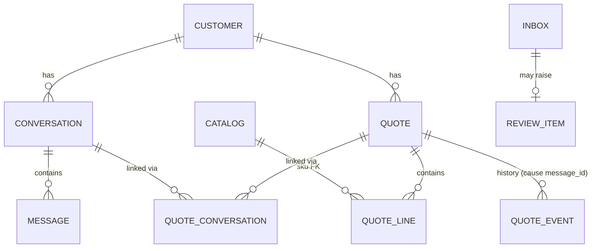

# Quote & State Engine

A headless API that turns colloquial WhatsApp conversations into draft quotes ("Oferta de Venta": SKUs + quantities, no pricing) and keeps them correct as messages keep arriving: revisions, a colleague asking from another chat, new requests mixed with old ones.

**In one line:** a small local model *interprets* text into a typed structure, deterministic code *decides* which quote a message touches, and anything ambiguous goes to a human instead of the ERP. Postgres is the only stateful dependency; inference is 100% local (Docker Model Runner + Qwen3-4B-Instruct-2507).

Depth: [docs/HLD.md](docs/HLD.md) (architecture, rationale) · [docs/LLD.md](docs/LLD.md) (schema, algorithms, API).

## 1. Quickstart

Requirements: Docker with Compose (`models:` support) and the Docker Model Runner plugin (`docker model`), [`just`](https://github.com/casey/just) (`uv tool install rust-just`), `curl`, `jq`.

```bash
just demo          # real model: builds, pulls the GGUF (~2.5 GB, first run only), runs the challenge end to end
just demo-replay   # no model: LLM outputs served from recorded fixtures; runs anywhere Docker runs
just up-gpu        # NVIDIA: reinstall the model runner with CUDA, then start the stack (then ./scripts/demo.sh)
just down          # stop and wipe the database volume
```

`scripts/demo.sh` posts Phase 1, then events 1–4 (printing the quotes after each), resends event 4 (duplicate), posts "mejor cancelalo" (review), prints the history of Q-002 and checks the final state against the challenge's expected JSON. On a CPU-only machine Phase 1 takes ~80 s; `?wait=true` waits up to 300 s.

The API listens on `${API_PORT:-8000}` (`API_PORT=8080 just demo` if 8000 is taken). Postgres has no host port. Some calls:

```bash
API=http://localhost:${API_PORT:-8000}
curl -s -X POST "$API/v1/conversations?wait=true" -H 'content-type: application/json' -d @fixtures/challenge/phase1.json
curl -s -X POST "$API/v1/messages?wait=true"      -H 'content-type: application/json' -d @fixtures/challenge/event4.json
curl -s "$API/v1/quotes?customer=C-10029" | jq          # the challenge's GET /quotes shape
curl -s "$API/v1/quotes/Q-002/history" | jq             # every event + the message that caused it
curl -s "$API/v1/reviews?customer=C-10029" | jq         # open human-review items with candidate quotes
REVIEW_ID=$(curl -s "$API/v1/reviews?customer=C-10029" | jq '.[-1].id')   # e.g. the "mejor cancelalo" review
curl -s -X POST "$API/v1/reviews/$REVIEW_ID/resolve" -H 'content-type: application/json' \
  -d '{"action":"apply","quote_id":"Q-002","expected_version":2,"ops":[{"op":"cancel"}]}'
curl -s "$API/health" | jq                              # {db, llm, model, model_present}
```

Without `?wait=true`, a POST returns `202 {inbox_seq, status_url}` immediately and `GET /v1/inbox/{seq}` shows the outcome and the full decision trace. State survives restarts (`docker compose restart api worker`).

Dev loop: `just test` (unit + integration on a testcontainers Postgres; no model needed), `just test-llm`, `just lint`, `just typecheck`, `just eval mode=cascade|llm|rules`.

## 2. Data model, and how a message finds its quote



Conversation ↔ quote is **many-to-many** through `quote_conversations(quote_id, conversation_id, linked_by_message_id, linked_at)`. Neither side holds the other's id, so event 2 (two chats → one quote) and event 3 (one chat → two quotes) are just rows. After the four events:

| quote_id | conversation_id | linked_by_message_id |
|---|---|---|
| Q-001 | wa-thread-411 | Phase 1 (synthetic id of the last history message) |
| Q-001 | wa-thread-662 | wamid.662.0001 (event 2) |
| Q-002 | wa-thread-411 | wamid.411.0232 (event 3) |
| Q-002 | wa-thread-662 | wamid.662.0002 (event 4) |

Everything else is plumbing around one idea: the **inbox** table is the webhook log, the dedupe index and the work queue at once, so dedupe and the state change commit in the same transaction.

**What decides the quote:** the router scores **every open quote of the customer** on the message *content*: +10 for an explicit quote id, +3 per mentioned product that the quote contains, +2 if the "previous quantity" matches a line. A unique positive maximum wins; a tie or zero goes to review. The chat the message arrived in is not a signal, with one exception: "agrega X" without "aparte" goes to the quote linked to this chat if there is exactly one.

### Event 4, function by function

*"perfecto. y de los acrilicos que cotizó Alice, mejor que sean 4"* arrives in Mario's chat `wa-thread-662`, which so far is linked only to Q-001.

1. `adapters/api/routes.py` · `post_message` validates the body as `MessageIn` and opens a `UnitOfWork`.
2. `application/ingest.py` · `ingest_message` hashes the canonical payload and calls `InboxRepo.insert` (`INSERT … ON CONFLICT (dedupe_key=message_id) DO NOTHING`). New → `Accepted(seq)` → 202. Same id and hash → 200 duplicate; same id, different payload → 409.
3. `worker.py` · `run` loops `application/process.py` · `process_next`, which in one transaction: `InboxRepo.claim` (oldest pending row whose customer has no earlier pending row, `FOR UPDATE SKIP LOCKED`), `pg_advisory_xact_lock(hashtext('C-10029'))`, opens a savepoint and calls `_message`.
4. `_message` stores the message (`MessageRepo.upsert_customer_conversation`, `recent`, `add`) and builds a `MessageCtx` with the last 10 chat messages.
5. `adapters/extractors/cascade.py` · `CascadeExtractor.interpret` tries `adapters/extractors/rules.py` · `RuleExtractor.interpret` first: `norm` → `_intent` matches "mejor que sean" → `update_qty`; the alias "acrilicos" → `[ARACBL-03-122244]`; `_bind` ties "sean 4" to it → `qty=4`. Every number is bound, so the rules are confident: `source="rules"`, **no LLM call**.
6. `domain/interpretation.py` · `validate_skus` re-checks the SKUs against the catalog.
7. `QuoteRepo.open_views("C-10029")` → Q-001 {lona 15, mesh 5, micro 5; chats 411, 662} and Q-002 {acrilico 2; chat 411}.
8. `domain/router.py` · `route` → `_pick` → `score`: **Q-001 = 0, Q-002 = 3** → Q-002. `_resolve_line` finds the single acrilico line → `Apply("Q-002", [LinkConversation("wa-thread-662"), SetQty("ARACBL-03-122244", 4)])`. The chat's existing link to Q-001 played no part.
9. `_execute` → `QuoteRepo.get_for_update("Q-002")` → `domain/quote.py` · `Quote.apply(ops, Cause("wamid.662.0002"))` validates the whole batch and emits `ConversationLinked(wa-thread-662)` and `LineQtyChanged(2→4)`; version 1 → 2.
10. `adapters/db/repos.py` · `QuoteRepo.save` upserts the quote row and lines, inserts the `quote_conversations` link (`linked_by_message_id=wamid.662.0002`) and the two `quote_events`; `InboxRepo.finish` stores `processed` plus the trace (interpretation, scores, decision, latency). Commit.

## 3. "mejor cancelalo"

With Q-001 and Q-002 open, "mejor cancelalo" has no content signal: no product, no quote id. The rules read it as a bare `cancel`, and the router only auto-applies a bare cancel when the customer has exactly **one** open quote. Here it returns `Review(ambiguous_quote, [Q-001, Q-002])`: the worker writes a `review_items` row with the message, the interpretation and both candidates, marks the inbox row `needs_review`, and **changes nothing**. A person sees it at `GET /v1/reviews` (candidates with their lines and versions) and decides with `POST /v1/reviews/{id}/resolve`, passing explicit ops and the `expected_version` of the quote; if the quote changed in the meantime the API answers 409 instead of applying a stale decision. The resulting events carry both the original `message_id` and the `review_id`. Other messages from the customer keep flowing while the review is open. This is implemented and covered by integration tests, not only described.

## 4. Deterministic vs. model

| Step | Who | What it may decide | What it must never decide | When it is wrong / gives up |
|---|---|---|---|---|
| Dedupe | Postgres unique index on `message_id` + payload hash | new / duplicate / conflict | — | — |
| Phase 1 extraction (whole conversation) | **LLM**, JSON-schema constrained | items + qty, reading both directions | a SKU outside the catalog (schema `enum`, then `validate_skus`, then a DB foreign key) | a wrong qty lands in a *draft* a human reviews before the ERP; no items / failure → review |
| Phase 2 interpretation | **Rules first** (`RuleExtractor`), LLM only when the rules return `None` | intent, product → candidate SKUs, qty, previous qty, "aparte", explicit quote ids | which quote; any state change | rules give up on unknown wording, any unbound number, negated cancel, a query with a qty, a cancel that names products → LLM. LLM failure / timeout / foreign SKU → review |
| Which quote | **Router**, pure code | target quote, new quote, review, no-op | — | tie, zero score, ambiguous line, update without a product → review |
| Is the change valid | **Quote aggregate** | accept / reject the op batch, all-or-nothing | — | `DomainError` → nothing applied, review `invalid_ops` with the rejected `Apply` as `proposed` |
| Ambiguity | **Human** via `/v1/reviews` | explicit ops | — | stale version → 409 |

The model never sees the quotes and never picks one; it only fills a typed form. Prompts are in `adapters/extractors/llm.py`; the model is called with temperature 0, 2 validation retries and a 180 s timeout.

## 5. Edge cases

| Case | What the system does | Why |
|---|---|---|
| "mejor cancelalo", 2 open quotes | review, no change | no content signal; guessing would push a wrong cancel |
| "mejor cancelalo", 1 open quote | cancels it | unambiguous |
| Event 4 resent byte-identical | 200 duplicate, state and version unchanged | dedupe on `message_id` + hash |
| Same `message_id`, different payload | 409 | a reused id is a client bug, not a repeat |
| Same text, new `message_id` | applied again | a real repeat request; never dedupe on text |
| "mejor que sean 15 las lonas" (quote has frontlit **and** mesh) | review `ambiguous_line` | "lonas" matches two lines; "no 20" (event 1) is what disambiguates |
| Same product in two open quotes | review `ambiguous_quote` (tie) | content can't separate them |
| "Q-002 …" in the text | that quote wins (+10) | explicit beats inferred |
| "agrega 2 acrilicos" (no "aparte"), chat linked to 1 quote | added there; if the SKU exists, qty is incremented | "add" reads as increment; chat linked to 0 or 2+ quotes → review |
| "mejor que sean 10" (no product) | review `unknown_product` | a link-only "success" would silently drop the update |
| Phase 1 thread posted again | review | must not create a duplicate quote |
| Outbound (rep) message in Phase 2 | stored as LLM context, never mutates | only the customer's requests change quotes |
| LLM down, times out, or returns junk | review `extraction_failed` | no state change without a confident interpretation |
| Same product twice in one message ("2 acrilicos … y 3 acrilicos") | quantities summed into one line for add/new; an update/remove giving one line two different qtys → review `ambiguous_line` | one line per SKU is a quote invariant |
| Decision rejected by the quote aggregate (`DomainError`) | review `invalid_ops`, inbox row `needs_review`, no change | every non-success outcome lands in `review_items` |
| Worker crash or infrastructure error mid-message | crash: rollback, row stays pending and is retried; exception: attempt counted, `failed` after 3 | claim + work + status in one transaction |
| Quote ids skip a number (Q-003 → Q-005) | cosmetic: ids are unique, not dense | Postgres sequences are non-transactional; a rolled-back creation burns an id |
| Two workers, same customer | processed strictly in arrival order | claim skips rows with an earlier pending row for the same customer + advisory lock |
| **Not handled:** relative/positional references ("la de ayer", "la segunda cotización") | usually review (no content match) | needs dates/order semantics in the router; low frequency, and review is a safe default |
| **Not handled:** the rep dictating changes in Phase 2 ("te dejo 12 entonces") | ignored for mutation | needs an authority model (who may change what); the rep has the review API |
| **Not handled:** late or out-of-order webhook delivery | processed in arrival order (`seq`), not by WhatsApp `timestamp` | reordering needs a buffering window; WhatsApp delivery is mostly ordered per chat |
| **Not handled:** units ("100 metros de lona" vs rollos), media, voice notes, edited/deleted messages | rules give up → LLM, which may or may not produce a qty | out of the timebox; they would need catalog unit metadata and extra webhook types |
| **Not handled:** "cancela las lonas" | depends on whether the LLM reads it as `remove_item` (removes the line) or `cancel` (cancels the quote that has lonas) | the rules give up on it deliberately; a product-scoped cancel should be a separate intent |

## 6. Trade-offs and scaling

**Trade-offs I chose:**

* **Rules before the model.** A regex lexicon is brittle Spanish, but costs nothing, is testable, and *gives up* rather than guesses: in the evals the rules made 0 wrong mutations. The four challenge events never touch the LLM.
* **Review over guessing.** More human work, but a wrong ERP quote costs more than a review click. Review rate is a KPI to watch.
* **The model call runs inside the claiming transaction.** Simple and correct (crash = rollback = retry), but it holds a DB connection and the customer's lock for the duration of the call.
* **`?wait=true` is best effort.** Worst-case LLM time is `LLM_TIMEOUT_S × (1 + max_retries)` (180 s × 3), which can exceed `WAIT_TIMEOUT_S` (300 s) on a slow CPU; the request then returns 202, processing continues, and `/v1/inbox/{seq}` has the outcome.
* **Postgres for everything** (state, queue, dedupe, locks, history). One thing to operate and back up; no dual-write failure modes.

**Scaling to 1,000 conversations/day.** That is under one conversation per minute; even at ~5 customer messages each it is ~10 messages/min during business hours. What breaks, in order:

1. **LLM throughput, not the database.** On the 2-core CPU VM a fallback interpretation takes ~22 s and a Phase 1 extraction ~80 s, one at a time. Everything the rules miss queues behind that. First fix: a GPU (`just up-gpu`), then parallel slots in the runner, then vLLM. Webhook timeouts are already a non-issue: the API answers 202 and the inbox absorbs bursts and WhatsApp retries.
2. **Locks held across the model call**, once there are several workers: each in-flight LLM call pins a connection. Fix: two-phase processing (interpret outside the transaction, route + apply inside with the version check that review resolution already uses).
3. **Catalog size.** A 4-SKU `enum` is free; 5,000 SKUs bloat the prompt and grammar. Fix: retrieval (FTS / pgvector) to build a top-k enum per message.
4. **Humans.** Review throughput becomes the real limit before Postgres does.

**Why no Redis:** at this volume Postgres `SKIP LOCKED` is plenty, and a separate queue/dedupe store means two writes in two systems: a crash between them loses a message or applies it twice. I'd add a broker only at ~100× the load or when several consumers need the same events.

**First thing with another week:** grow the golden set from real anonymized chats (23 hand-written cases is a smoke test, not a measurement), then two-phase processing so the model call leaves the transaction.

**What I'd rip out:** `?wait=true`. It exists so the demo reads top to bottom, but it holds an HTTP request open for minutes while polling the database. A real webhook should get a 202, and clients should read `/v1/inbox/{seq}` or get a callback.

## 7. Eval results

23 golden cases (`evals/golden.jsonl`): the challenge events, paraphrases, typos, numbers in words, traps ("gracias!", "lona 5x100") and explicit quote ids. Each case runs extraction + routing against fixed open quotes; "routing acc" requires the right target **and** the right ops. "Wrong mutation" = an apply/new-quote that differs from the expected one; "safe miss" = review where an apply was expected.

| Hardware | Mode | intent acc | SKU-set acc | routing acc | solved by rules | p50 | p95 | review rate | wrong mutations | safe misses |
|---|---|---|---|---|---|---|---|---|---|---|
| VM, 2-core ARM64 CPU, no GPU | `cascade` (rules → LLM) | 100% | 91% | 96% | 43% | 3.3 s | 23.9 s | 17% | 0 | 1 |
| VM, 2-core ARM64 CPU, no GPU | `llm` only | 96% | 87% | 91% | 0% | 22.5 s | 26.9 s | 22% | 0 | 2 |
| VM, 2-core ARM64 CPU, no GPU | `rules` only | 43% | 57% | 48% | 43% | 0 ms | 0 ms | 65% | 0 | 12 |

GPU numbers are to be measured with `just up-gpu` + `just eval` (not yet run).

Reading: the cascade beats the LLM alone on accuracy *and* skips the model for 43% of messages (the golden set over-weights hard phrasings; real traffic should do better). Rules alone are safe but give up too often. No mode produced a wrong mutation. Full per-case output: `evals/results-*.md` / `.json`.

## 8. How I used AI tools

I built this with Claude Code. The design came out of a structured brainstorming session (spec → HLD/LLD → a task-by-task plan), and implementation was subagent-driven: one agent per task with TDD, followed by a separate review pass per task before moving on. I made the key calls myself: 100% local inference, Postgres over Redis, and switching the runtime from Ollama to Docker Model Runner midway. The per-task reviews paid off: they caught a multi-worker race in the retry bookkeeping (another worker could claim a row between rollback and the attempt counter), an item-less update that was silently "applied" as a link-only no-op, and an eval metric that flattered the system by scoring only the target quote and not the ops. The docs in `docs/` started as the pre-implementation design and were updated to match the code as built.
