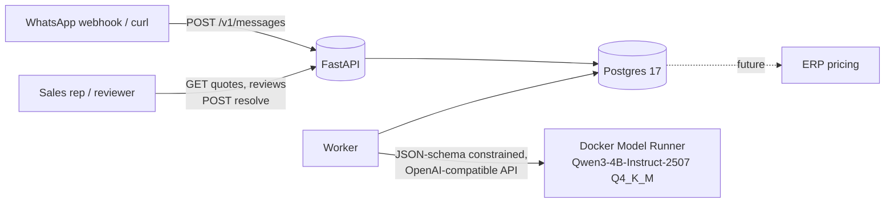
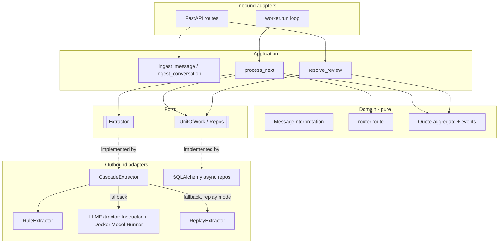
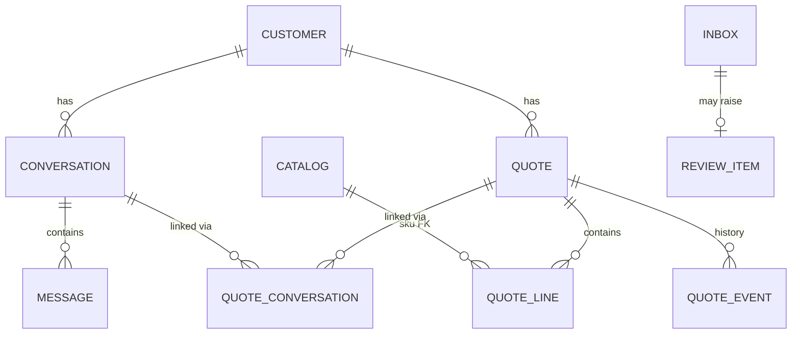
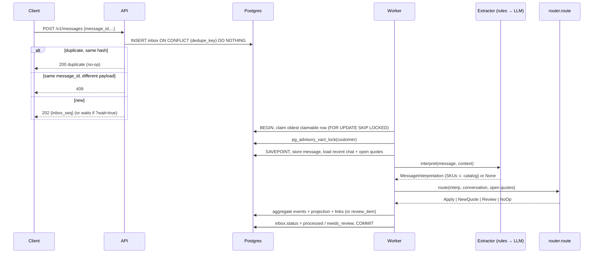

# HLD — Quote & State Engine

High-level design for the Axial take-home "The Quote & State Engine". Audience: Axial engineering / CTO. The companion [LLD](LLD.md) has schemas, contracts and algorithms. Both documents describe the code as it is in this repository.

## 1. Problem

A sales rep receives quote requests over WhatsApp. Requests are colloquial and spread over several messages. Then:

* customers revise quantities;
* a colleague asks about the same quote from another chat;
* new requests arrive mixed in with old ones.

We need a **headless API** that:

1. turns a conversation into a structured draft quote (SKUs + quantities, no pricing);
2. **keeps every quote correct as new messages arrive**, across chats, without mixing quotes up and without guessing.

## 2. Design principles

| Principle | Consequence |
|-----------|-------------|
| **Models interpret, code decides.** | The LLM only turns text into a typed `MessageInterpretation`. A pure, deterministic router decides which quote a message affects. The aggregate decides whether the change is valid. |
| **Invalid SKUs are unrepresentable.** | The catalog is compiled into the JSON Schema `enum` used for constrained decoding, validated again in Python (`validate_skus`), and enforced by a foreign key in the DB. |
| **Cheap first, model last.** | A rule-based extractor handles the common phrasing at zero token cost. The LLM is called only when the rules give up. |
| **When unsure, ask a human.** | Ambiguous messages create a review item. No quote changes and nothing reaches the ERP. |
| **Every change has a cause.** | Append-only quote events; each one references the `message_id` (and `review_id`, if any) that caused it. |
| **One stateful dependency.** | Postgres is the store, the queue, the dedupe log and the lock manager. |
| **100% local inference.** | Docker Model Runner serving Qwen3-4B-Instruct-2507 (Q4_K_M GGUF). No cloud LLM calls. |

## 3. System context

## 4. Containers (docker compose)

| Service | Role | Scales by |
|---------|------|-----------|
| `api`   | Runs migrations + catalog seed at startup, then validates payloads, writes them to the inbox (idempotent), serves reads and review resolution. Stateless. | Replicas behind a load balancer |
| `worker` | Claims inbox rows, runs the pipeline, commits the new state. Stateless. | Replicas (safe because of `SKIP LOCKED` + a per-customer ordering guard + advisory lock) |
| `postgres` | Domain state, inbox/queue, event log, review queue. Internal only (no host port). | Vertical first; read replicas for GETs |
| `models: llm` (Compose top-level element) | Docker Model Runner pulls and serves `hf.co/unsloth/Qwen3-4B-Instruct-2507-GGUF:Q4_K_M` with `context_size: 8192`; Compose injects `LLM_BASE_URL` / `LLM_MODEL` into `api` and `worker`. CPU by default; `just up-gpu` reinstalls the runner with CUDA. | Parallel slots in the runner, then vLLM |

`compose.replay.yaml` removes the model entirely (`EXTRACTOR_MODE=replay`): LLM outputs are served from recorded fixtures, so the demo runs on any machine with Docker.

## 5. Component view (hexagonal)

## 6. Data model (conceptual)

**The key decision: conversation ↔ quote is many-to-many.**

* A conversation never stores a `quote_id`. If it did, event 3 would break: one chat feeds two quotes.
* A quote never stores a `conversation_id`. If it did, event 2 would break: two chats feed one quote.
* The `quote_conversations` link table records when each link was created and which message created it.

## 7. Webhook → stored state

Claim and work share one transaction. If the work raises, only the savepoint is rolled back and the failure is recorded on the still-locked row (`attempts += 1`, `failed` at 3 or on a `DomainError`), so no other worker can pick the row up in between. A crash rolls everything back and the row stays `pending`.

## 8. Deterministic vs. model

| Step | Who decides | May decide | Must never decide | When it is wrong |
|------|-------------|------------|-------------------|------------------|
| Dedupe | Postgres `UNIQUE (dedupe_key)` + payload hash | duplicate, conflict or new | —                 | —                |
| Phase 1 extraction | **LLM** (constrained) | items + qty from a whole conversation | SKUs outside the catalog (impossible: enum + check + FK) | A wrong qty/item lands in a **draft**; a human sees it before the ERP. A thread that already feeds a quote goes to review instead of creating a duplicate. |
| Phase 2 interpretation | **Rules first**, LLM fallback | intent, product mentions → candidate SKUs, qty, previous qty, "separate" flag, explicit quote ids | which quote; any state change | A bad interpretation usually yields no or ambiguous matches → review. Measured by the golden-set evals. |
| Quote routing | **Router (pure code)** | target quote, or review | —                 | Gives up (review) on a tie, no content signal, an ambiguous line, or an update without items |
| Mutation validity | **Quote aggregate** | accept or reject an op batch | —                 | Raises `DomainError` → savepoint rolled back → inbox row `failed` |
| Ambiguity | **Human** via `/v1/reviews` | explicit ops, guarded by the quote version | —                 | 409 if the quote changed meanwhile |

## 9. How a message finds its quote

* Candidates are **all open quotes of the customer**, not only the quotes linked to the chat.
* Each candidate is scored only on **message content**:
  * explicit quote id: +10;
  * product overlap with the quote's lines: +3 per item;
  * the "previous quantity" matches a line: +2.
* A unique, positive maximum wins. A tie or zero → review.
* The chat the message came from is **not a routing signal**. Single exception: "add X" without "aparte" goes to the quote linked to this chat if there is exactly one; otherwise review. If that quote already has the SKU, the add becomes `SetQty(existing + qty)`.
* An update or removal with no product → review (`unknown_product`), never a silent link-only change.
* Once a message is applied to a quote, its chat gets linked to that quote.

**Event 4:** *"y de los acrilicos que cotizó Alice, mejor que sean 4"* arrives from Mario's chat (wa-thread-662).

* Rules extract `update_qty`, {ARACBL-03-122244}, qty 4.
* Q-001 scores 0 and Q-002 scores 3, so Q-002 wins, even though 662 was linked only to Q-001.
* Result: `ConversationLinked(Q-002, 662)`, then `LineQtyChanged 2→4`.

## 10. Knowing when not to guess

With two open quotes, *"mejor cancelalo"* has no content signal.

* The router returns `Review(ambiguous_quote, [Q-001, Q-002])`.
* A `review_item` is stored with the message, the interpretation and both candidates.
* No quote changes and nothing is pushed to the ERP.
* A person resolves it through `POST /v1/reviews/{id}/resolve` with explicit ops and the `expected_version` of the quote. If the quote changed in the meantime, the API returns 409.
* Other messages from the customer keep flowing while the review is open.

## 11. Quality attributes

| Attribute | Mechanism |
|-----------|-----------|
| Correctness under retries | Transactional inbox: dedupe by `message_id`; the state change and `inbox.status` commit in one transaction |
| Ordering  | Claim query skips rows whose customer has an earlier pending row; per-customer advisory lock; arrival order (`seq`) |
| Durability / restart | All state in Postgres; worker and API are stateless; a crash mid-message rolls back and the row is retried |
| Auditability | `quote_events` (append-only, with cause) + `inbox.decision` trace: extractor source, interpretation JSON, router scores, decision, latency |
| Testability | Pure router and aggregate; replay extractor; testcontainers for real-Postgres acceptance tests |
| Measurability | Golden-set evals: intent / SKU / routing accuracy, % solved without the LLM, p50/p95 latency, review rate, wrong mutations |

## 12. Scaling to 1,000 conversations/day — what breaks first

That is less than 1 message per minute on average, with business-hour bursts. In order:

1. **LLM throughput.** On the 2-core CPU VM an LLM fallback takes ~22 s and a Phase 1 extraction ~80 s, with one request at a time; a burst queues up behind it. The cascade keeps the common phrasing off the LLM; a GPU (`just up-gpu`) is the first real fix, then parallel slots, then vLLM with continuous batching.
2. **LLM call inside the transaction.** The worker holds a DB connection, the row lock and the customer's advisory lock during the model call. Fine at one worker; with many workers it pins connections. Next: two-phase processing (interpret outside the transaction, then re-read and route inside it with a version check).
3. **Catalog size.** An `enum` with thousands of SKUs bloats the prompt and the grammar. Next: retrieval (Postgres FTS / pgvector) to build a top-k dynamic enum per message.
4. **Human review throughput.** Track the review rate as a product KPI.

Postgres is not the bottleneck at this volume.

**Why no Redis:**

* A separate Redis dedupe or queue would mean two writes in two systems: a crash between them either loses a message or applies it twice.
* Move to a broker (Redis Streams, NATS) only at roughly 100× this load, or when several consumers need the same events.

## 13. Technology choices

| Area | Choice | Rejected |
|------|--------|----------|
| Tooling | uv, ruff, ty (pre-commit) + pyright (CI), just | pip/poetry, black + flake8 |
| LLM I/O | Instructor in `JSON_SCHEMA` mode over Docker Model Runner's OpenAI-compatible API | Pydantic AI (an agent framework; there is no agent here) |
| LLM runtime | Docker Model Runner (Compose `models:` element, llama.cpp backend) | Ollama (the original plan; DMR plugs into Compose as a `models:` element, with no extra runtime or pull service) |
| Model | Qwen3-4B-Instruct-2507 Q4_K_M (non-thinking; fits 6 GB VRAM; strong JSON validity) | Thinking models (empty JSON content), larger models (CPU latency) |
| Store / queue | Postgres 17, SQLAlchemy 2 async, Alembic | Redis, RabbitMQ |
| Evals / observability | pydantic-evals, structlog JSON logs | Tracing stack (not built; `OTEL_EXPORTER_OTLP_ENDPOINT` is reserved but unused) |

## 14. Out of scope (deliberately)

* Pricing / ERP integration.
* Real Meta webhook signature verification.
* Auth, UI.
* Media and voice notes.
* Edited or deleted messages.
* Unit conversion.
* Rep-dictated changes in Phase 2 (outbound messages are stored as context only).
* Relative or positional references ("la de ayer", "la segunda"): these go to review.
